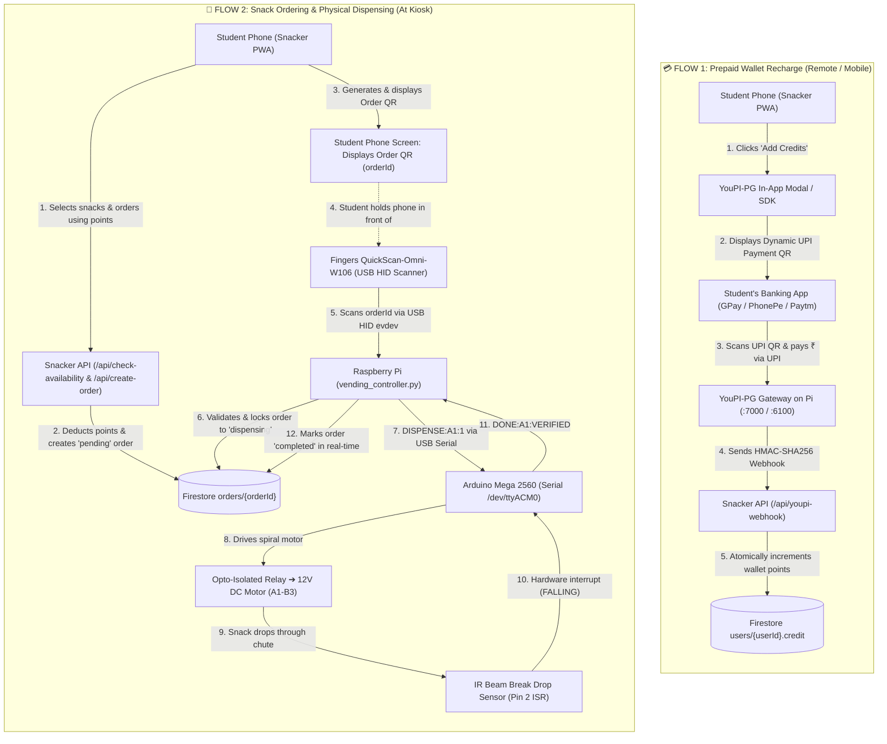

# SNACKER Backend & Hardware Infrastructure 🍫⚙️

Welcome to the **SNACKER Backend** repository. This repository houses the complete backend services, hardware automation daemons, Arduino firmware, and Firebase security architecture powering the SNACKER automated smart vending machine.

---

## 📑 Table of Contents

- [System Architecture](#-system-architecture)
- [Hardware & Circuit Engineering](#%EF%B8%8F-hardware--circuit-engineering)
  - [Bill of Materials (BOM)](#bill-of-materials-bom)
  - [Pinout & Channel Mapping](#pinout--channel-mapping)
  - [Reverse-Current & Back-EMF Protection](#reverse-current--back-emf-protection)
- [Arduino Mega Firmware](#-arduino-mega-firmware)
  - [Serial Command Protocol](#serial-command-protocol)
  - [Bench Testing & Diagnostics](#bench-testing--diagnostics)
- [Raspberry Pi Vending Daemon](#-raspberry-pi-vending-daemon)
  - [Fingers QuickScan USB Interception](#fingers-quickscan-usb-interception)
  - [Order Locking & Replay Protection](#order-locking--replay-protection)
  - [IR Drop Verification & Auto-Refund](#ir-drop-verification--auto-refund)
- [Firebase Architecture & Security Rules](#-firebase-architecture--security-rules)
  - [Firestore Security Rules](#firestore-security-rules)
  - [Realtime Database Rules](#realtime-database-rules)
- [Backend REST API](#-backend-rest-api)
- [Raspberry Pi Deployment Guide](#-raspberry-pi-deployment-guide)
  - [Automated Setup](#automated-setup)
  - [Systemd Services](#systemd-services)
  - [Nginx Reverse Proxy](#nginx-reverse-proxy)
- [Domain Migration & Production Guide (Docs)](#-domain-migration--production-guide)
- [Contributing & License](#-license)

---

## 🏛️ System Architecture

SNACKER divides operations into two decoupled, independent lifecycles: **Prepaid Wallet Recharge** and **Physical Snack Vending**.



### 🏷️ The Two Distinct QR Codes in SNACKER

To prevent any confusion between payment and dispensing, SNACKER uses two completely separate QR systems:

| Feature | 💳 1. Payment QR (Wallet Recharge) | 🍫 2. Order QR (Physical Vending) |
| :--- | :--- | :--- |
| **Purpose** | To convert real money (INR) into wallet points (₹1 = 1 pt) | To authorize and trigger physical snack dispensing |
| **Generated By** | **YouPI-PG Gateway** | **SNACKER Frontend PWA** (`react-qr-code`) |
| **Rendered At** | Inside the YouPI popup modal / checkout drawer | On the student's phone screen (`/orders` & Order Success modal) |
| **Payload** | Standard UPI payment intent URI (`upi://pay?pa=...&am=...`) | Alphanumeric Firestore order ID (`nanoid`, e.g. `V1StGXR8_Z`) |
| **Scanned By** | **Student's banking app** (GPay, PhonePe, Paytm, BHIM) | **Fingers QuickScan-Omni-W106** USB scanner on the machine |
| **Handled By** | Bank UPI network ➔ YouPI-PG ➔ `/api/youpi-webhook` | Raspberry Pi daemon (`vending_controller.py`) ➔ Arduino Mega |

---

## 🛠️ Hardware & Circuit Engineering

### Bill of Materials (BOM)

| Component | Specification | Function |
| :--- | :--- | :--- |
| **SBC** | Raspberry Pi 3B+ / 4B / 5 (64-bit OS) | Kiosk controller, Firestore client, USB manager |
| **Microcontroller** | Arduino Mega 2560 R3 | Low-level relay timing, motor PWM, hardware ISR |
| **QR Scanner** | Fingers QuickScan-Omni-W106 | High-speed omnidirectional USB barcode reader |
| **Actuators** | 6x 12V DC High-Torque Spiral Motors | Rotates vending spirals for channels A1–A3, B1–B3 |
| **Power Supply** | 12V 10A DC Regulated PSU | Powers motors and relay coils |
| **Relay Driver** | 6/8-Channel Opto-Isolated Relay Board | Galvanic isolation between 5V Arduino and 12V motors |
| **Drop Sensor** | Active Low Infrared (IR) Beam Sensor | Senses falling snack package across drop chute |
| **Diodes** | 6x 1N4007 or 1N5819 Schottky | Flyback suppression across motor leads |
| **Feedback** | 5V Active Buzzer + Green/Red LEDs | Acoustic and visual vending status |

### Pinout & Channel Mapping

| Channel | Snack Item (Default) | Arduino Mega Pin | Protection / Interface |
| :---: | :---: | :---: | :---: |
| **A1** | Classic Salted Lays | **Digital Pin 22** | Relay IN1 (Active LOW) |
| **A2** | Doritos Nacho Cheese | **Digital Pin 24** | Relay IN2 (Active LOW) |
| **A3** | Oreo Vanilla Cookies | **Digital Pin 26** | Relay IN3 (Active LOW) |
| **B1** | Snickers Chocolate Bar | **Digital Pin 28** | Relay IN4 (Active LOW) |
| **B2** | Coca-Cola Can 300ml | **Digital Pin 30** | Relay IN5 (Active LOW) |
| **B3** | KitKat 4-Finger Wafer | **Digital Pin 32** | Relay IN6 (Active LOW) |
| **IR Sensor** | Drop Detection Beam | **Digital Pin 2** | Hardware Interrupt `INT.0` |
| **Green LED** | Dispense Active / Success | **Digital Pin 12** | 220Ω Resistor |
| **Red LED** | Fault / Jamming Indicator | **Digital Pin 11** | 220Ω Resistor |
| **Buzzer** | Acoustic Confirmation | **Digital Pin 10** | 5V Active Buzzer |

### Reverse-Current & Back-EMF Protection

When inductive loads (DC motors) switch off, collapsing magnetic fields induce high-voltage reverse transient spikes that can reboot microcontrollers or destroy GPIO transistors.

```
+12V DC Supply ──────────────────┬─────────────────────────────┐
                                 │                             │
                            ┌────┴────┐                        │
                            │  Motor  │                 [Flyback Diode]
                            │ Coil M1 │                (1N4007 / 1N5819)
                            └────┬────┘                 Cathode to +12V
                                 │                      Anode to Relay NO
                                 ├─────────────────────────────┘
                                 │
                         [Relay COM / NO]
                      (Optocoupler Isolated)
                                 │
GND (12V Supply) ────────────────┴─────────────────────────────┘
```

1. **Flyback Diodes**: A 1N4007 diode is soldered across each motor terminal (Cathode with silver band to `+12V`, Anode to Relay `NO`).
2. **Optocoupler Isolation**: Remove the `JD-VCC` jumper on the relay module. Wire external +5V to `JD-VCC`, and wire Arduino +5V strictly to `VCC`. Do not connect Arduino GND to relay coil GND.

---

## ⚡ Arduino Mega Firmware

The production firmware is located in [`hardware/arduino/snacker_firmware/snacker_firmware.ino`](hardware/arduino/snacker_firmware/snacker_firmware.ino).

### Serial Command Protocol

All commands operate at **115200 baud** over USB Serial (`/dev/ttyACM0`):

| Command | Direction | Description | Response Example |
| :--- | :---: | :--- | :--- |
| `PING` | Host ➔ Mega | Keep-alive check | `PONG` |
| `STATUS` | Host ➔ Mega | Slot inventory & IR beam check | `INFO:SLOTS=A1,A2,A3,B1,B2,B3;DROP_SENSOR=CLEAR` |
| `TEST_ALL` | Host ➔ Mega | Diagnostic sequence (600ms per slot) | `INFO:STARTING_SELF_TEST` ... `INFO:SELF_TEST_COMPLETE` |
| `DISPENSE:<SLOT>:<QTY>` | Host ➔ Mega | Dispense snack from slot | `STATUS:DISPENSING:A1` ➔ `DONE:A1:VERIFIED` |
| `STOP` | Host ➔ Mega | Emergency motor shutoff | `ALL_MOTORS_STOPPED` |

### Bench Testing & Diagnostics

A standalone bench testing sketch is available in [`hardware/arduino/diagnostic_test/diagnostic_test.ino`](hardware/arduino/diagnostic_test/diagnostic_test.ino). Upload this sketch to verify individual relays by sending keys `1` through `6`, `ALL`, or `STOP` via the Arduino Serial Monitor.

---

## 🥧 Raspberry Pi Vending Daemon

The hardware controller runs as a headless Linux daemon located in [`hardware/pi/vending_controller.py`](hardware/pi/vending_controller.py).

### Fingers QuickScan USB Interception

The **Fingers QuickScan-Omni-W106** operates in USB HID keyboard emulation mode. In a headless environment without an X11 window manager, the controller uses Python's `evdev` library to intercept raw input events directly from `/dev/input/event*`.

- **Exclusive Grab**: The daemon invokes `scanner.grab()` to intercept scan events exclusively, preventing raw characters from polluting the Linux console.
- **Nanoid Decoding**: Maps scancodes accurately including Shift key states to reliably decode full 10-character nanoids (`A-Z`, `a-z`, `0-9`, `_`, `-`).

### Order Locking & Replay Protection

When a QR code is scanned:
1. The daemon queries Firestore `orders/{orderId}`.
2. If `status == "pending"`, it atomically transitions the order to `"dispensing"` with `dispensedAt: SERVER_TIMESTAMP`.
3. If scanned again while dispensing or completed, the order is immediately rejected, eliminating replay attacks.

### IR Drop Verification & Auto-Refund

If the spiral motor rotates for `4500ms` without the falling snack breaking the IR beam:
1. The Arduino stops the motor and reports `WARN:<SLOT>:NO_DROP_DETECTED`.
2. The daemon marks the order as `"jammed"`.
3. An automated transaction refunds the order amount back to `users/{userId}.credit`.
4. The incident is logged into Firestore collection `errors/` for maintenance inspection.

---

## 🔒 Firebase Architecture & Security Rules

### Firestore Security Rules

Publish these rules in **Firebase Console ➔ Firestore Database ➔ Rules**:

```javascript
rules_version = '2';
service cloud.firestore {
  match /databases/{database}/documents {

    // 1. Products: anyone can read product details and stock.
    // Client writes blocked (only backend Admin SDK can mutate catalog & stock).
    match /products/{productId} {
      allow read: if true;
      allow write: if false;
    }

    // 2. Users: clients can read user profile and wallet points.
    // Client writes blocked to prevent client-side credit injection.
    match /users/{userId} {
      allow read: if true;
      allow write: if false;
    }

    // 3. Orders: users can view order history and real-time status.
    // Client writes blocked (orders are created & updated via server routes).
    match /orders/{orderId} {
      allow read: if true;
      allow write: if false;
    }

    // 4. Payments: private audit records (server only).
    match /payments/{paymentId} {
      allow read, write: if false;
    }

    // 5. Errors: internal error logs (server & Pi only).
    match /errors/{errorId} {
      allow read, write: if false;
    }

    // Fallback: deny all
    match /{document=**} {
      allow read, write: if false;
    }
  }
}
```

### Realtime Database Rules

For maintenance indicators:

```json
{
  "rules": {
    "onStockUpdation": {
      "status": {
        ".read": true,
        ".write": false
      }
    },
    ".read": false,
    ".write": false
  }
}
```

---

## 🚀 Backend REST API

The standalone backend server is located in [`api/server.js`](api/server.js) (Express running on port 5000):

| Endpoint | Method | Description |
| :--- | :---: | :--- |
| `/health` | `GET` | Health check & service uptime |
| `/api/check-availability` | `POST` | Atomic Firestore transaction checking wallet balance & stock |
| `/api/create-order` | `POST` | Generates verified order with nanoid QR payload |
| `/api/youpi-webhook` | `POST` | Receives YouPI-PG UPI payment confirmations (HMAC-SHA256 verified) |
| `/api/order` | `POST` | Starts a dynamic UPI payment session on YouPI-PG |
| `/api/auth-sync` | `POST` | Syncs user authentication profile and initializes wallet |
| `/api/admin/actions` | `POST` | Admin inventory controls, stock updates, and maintenance mode |
| `/api/cancel-reservation` | `POST` | Rollback stock reservation on cancelled checkouts |

---

## 📦 Raspberry Pi Deployment Guide

### Automated Setup

Clone and execute the installation script on the Raspberry Pi:

```bash
git clone https://github.com/djmahe4/snacker-backend.git /home/pi/snacker
cd /home/pi/snacker
chmod +x hardware/pi/setup_pi.sh
./hardware/pi/setup_pi.sh
```

The script automatically:
1. Installs system packages, Python venv, and **Node.js 24 LTS** (for native `node:sqlite`).
2. Configures `udev` rules allowing non-root hardware access to the Fingers QuickScan scanner and Arduino Mega.
3. Clones and provisions **`gxurav1710/youpi-pg`** at `/home/pi/youpi-pg` with embedded SQLite, cryptographic keys, and database tables.
4. Registers and starts all **systemd background daemons** (`youpi-pg.service`, `snacker-vending.service`).
5. Configures the unified **Nginx reverse proxy** with WebSocket and unbuffered SSE/webhook support.

---

### Systemd Services

| Service | Unit File | Description | Port / Path |
| :--- | :--- | :--- | :--- |
| **YouPI-PG Gateway** | `/etc/systemd/system/youpi-pg.service` | Dynamic UPI FCFS queue engine | `:7000` (Checkout), `:6100` (API), `:6001` (Admin) |
| **Vending Controller** | `/etc/systemd/system/snacker-vending.service` | USB QR scanner & Arduino Mega controller | `/dev/input/event*` + `/dev/ttyACM0` |
| **Snacker Web App** | `/etc/systemd/system/snacker-backend.service` | Client PWA / API Handlers | `:3000` |

#### Live Log Monitoring:
```bash
# Vending QR scanner and motor logs
sudo journalctl -u snacker-vending.service -f

# YouPI-PG payment gateway transactions
sudo journalctl -u youpi-pg.service -f
```

---

### Nginx Reverse Proxy & Port Architecture

Nginx routes all traffic on Port 80, cleanly multiplexing the frontend, the payment gateway, and the hardware webhook receiver:

```
                  Port 80 (Public / LAN)
                            │
               ┌────────────┴────────────┐
               │   Nginx Reverse Proxy   │
               └────────────┬────────────┘
                            │
     ┌──────────────────────┼──────────────────────┬──────────────────────┐
     ▼                      ▼                      ▼                      ▼
  Next.js App        YouPI Checkout         YouPI REST API         Payment Webhook
 (Port 3000)           (Port 7000)            (Port 6100)          (Unbuffered Raw)
    `/*`           `/checkout/*`, `/youpi.js`  `/api/v1/*`      `/api/youpi-webhook`
```

Apply the Nginx configuration:
```bash
sudo cp hardware/pi/nginx/snacker.conf /etc/nginx/sites-available/snacker
sudo ln -sf /etc/nginx/sites-available/snacker /etc/nginx/sites-enabled/
sudo nginx -t && sudo systemctl reload nginx
```

---

## 🌐 Domain Migration & Production Guide

For comprehensive documentation on transitioning the system to production:
- **Full Custom Domain Migration**: [Domain Migration & Production Deployment Guide](docs/DOMAIN_MIGRATION_AND_DEPLOYMENT.md)
- **Plan B (Named Cloudflare Tunnel + Custom Domain)**: [Plan B: Hybrid Cloud Architecture](docs/PLAN_B_CLOUDFLARED_VERCEL_PI_NGINX.md)
- **Plan B (Zero-Domain Pure Quick Tunnel `*.trycloudflare.com`)**: [Plan B: Zero-Domain Architecture](docs/PLAN_B_PURE_CLOUDFLARED_TRYCLOUDFLARE.md)
- **Topics Covered**:
  * Environment variable matrix (local vs production for both Frontend & Backend)
  * Nginx SSL termination with Certbot
  * Multi-subdomain routing (`snacker.*`, `pay.*`, `api-pay.*`)
  * Cloudflare Tunnel setup to bypass campus router firewall / CGNAT
  * Zero-domain ephemeral URL auto-sync to Firestore (`sync_quick_tunnel.py`)
  * Firebase & Clerk authorized domain whitelisting
  * PWA Service Worker HTTPS installation rules

---

## 📄 License

This project is licensed under the [MIT License](LICENSE).
