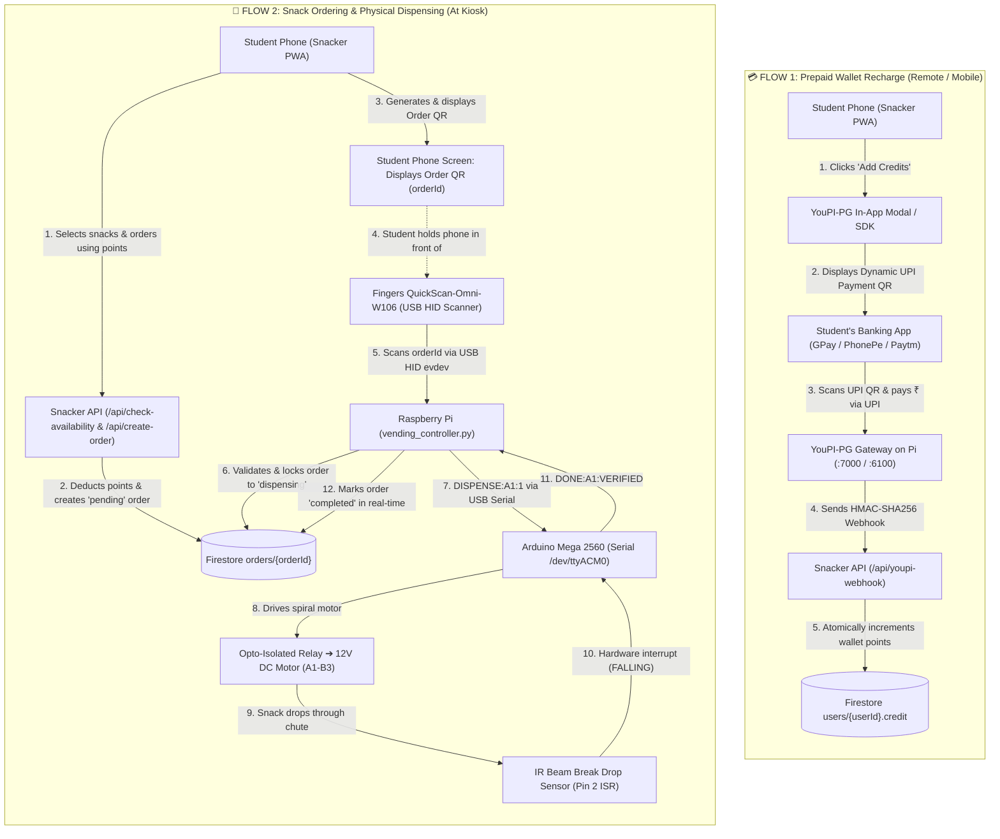

# SNACKER Backend & Hardware Infrastructure 🍫⚙️

Welcome to the **SNACKER Backend** repository. This repository houses the complete backend services, hardware automation daemons, Arduino firmware, and Firebase security architecture powering the SNACKER automated smart vending machine.

---

## 📑 Table of Contents

- [System Architecture](#-system-architecture)
- [Hardware & Circuit Engineering](#%EF%B8%8F-hardware--circuit-engineering)
  - [Bill of Materials (BOM)](#bill-of-materials-bom)
  - [Pinout & Channel Mapping](#pinout--channel-mapping)
  - [Reverse-Current & Back-EMF Protection](#reverse-current--back-emf-protection)
- [Arduino Mega Firmware](#-arduino-mega-firmware)
  - [Serial Command Protocol](#serial-command-protocol)
  - [Bench Testing & Diagnostics](#bench-testing--diagnostics)
- [Raspberry Pi Vending Daemon](#-raspberry-pi-vending-daemon)
  - [Fingers QuickScan USB Interception](#fingers-quickscan-usb-interception)
  - [Order Locking & Replay Protection](#order-locking--replay-protection)
  - [IR Drop Verification & Auto-Refund](#ir-drop-verification--auto-refund)
- [Firebase Architecture & Security Rules](#-firebase-architecture--security-rules)
  - [Firestore Security Rules](#firestore-security-rules)
  - [Realtime Database Rules](#realtime-database-rules)
- [Backend REST API](#-backend-rest-api)
- [Raspberry Pi Deployment Guide](#-raspberry-pi-deployment-guide)
  - [Automated Setup](#automated-setup)
  - [Systemd Services](#systemd-services)
  - [Debugging](#debugging)
  - [Nginx Reverse Proxy](#nginx-reverse-proxy)
- [Domain Migration & Production Guide (Docs)](#-domain-migration--production-guide)
- [Contributing & License](#-license)

---

## 🏛️ System Architecture

SNACKER divides operations into two decoupled, independent lifecycles: **Prepaid Wallet Recharge** and **Physical Snack Vending**.



### 🏷️ The Two Distinct QR Codes in SNACKER

To prevent any confusion between payment and dispensing, SNACKER uses two completely separate QR systems:

| Feature | 💳 1. Payment QR (Wallet Recharge) | 🍫 2. Order QR (Physical Vending) |
| :--- | :--- | :--- |
| **Purpose** | To convert real money (INR) into wallet points (₹1 = 1 pt) | To authorize and trigger physical snack dispensing |
| **Generated By** | **YouPI-PG Gateway** | **SNACKER Frontend PWA** (`react-qr-code`) |
| **Rendered At** | Inside the YouPI popup modal / checkout drawer | On the student's phone screen (`/orders` & Order Success modal) |
| **Payload** | Standard UPI payment intent URI (`upi://pay?pa=...&am=...`) | Alphanumeric Firestore order ID (`nanoid`, e.g. `V1StGXR8_Z`) |
| **Scanned By** | **Student's banking app** (GPay, PhonePe, Paytm, BHIM) | **Fingers QuickScan-Omni-W106** USB scanner on the machine |
| **Handled By** | Bank UPI network ➔ YouPI-PG ➔ `/api/youpi-webhook` | Raspberry Pi daemon (`vending_controller.py`) ➔ Arduino Mega |

---

## 🛠️ Hardware & Circuit Engineering

### Bill of Materials (BOM)

| Component | Specification | Function |
| :--- | :--- | :--- |
| **SBC** | Raspberry Pi 3B+ / 4B / 5 (64-bit OS) | Kiosk controller, Firestore client, USB manager |
| **Microcontroller** | Arduino Mega 2560 R3 | Low-level relay timing, motor PWM, hardware ISR |
| **QR Scanner** | Fingers QuickScan-Omni-W106 | High-speed omnidirectional USB barcode reader |
| **Actuators** | 6x 12V DC High-Torque Spiral Motors | Rotates vending spirals for channels A1–A3, B1–B3 |
| **Power Supply** | 12V 10A DC Regulated PSU | Powers motors and relay coils |
| **Relay Driver** | 6/8-Channel Opto-Isolated Relay Board | Galvanic isolation between 5V Arduino and 12V motors |
| **Drop Sensor** *(optional)* | Active Low Infrared (IR) Beam Sensor | Verifies a snack fell. Not required: without it the firmware runs each motor for a fixed time (`USE_IR_SENSOR = false`) |
| **Diodes** | 6x 1N4007 or 1N5819 Schottky | Flyback suppression across motor leads |
| **Feedback** | 5V Active Buzzer + Green/Red LEDs | Acoustic and visual vending status |

### Pinout & Channel Mapping

| Channel | Snack Item (Default) | Arduino Mega Pin | Protection / Interface |
| :---: | :---: | :---: | :---: |
| **A1** | Classic Salted Lays | **Digital Pin 22** | Relay IN1 (Active LOW) |
| **A2** | Doritos Nacho Cheese | **Digital Pin 24** | Relay IN2 (Active LOW) |
| **A3** | Oreo Vanilla Cookies | **Digital Pin 26** | Relay IN3 (Active LOW) |
| **B1** | Snickers Chocolate Bar | **Digital Pin 28** | Relay IN4 (Active LOW) |
| **B2** | Coca-Cola Can 300ml | **Digital Pin 30** | Relay IN5 (Active LOW) |
| **B3** | KitKat 4-Finger Wafer | **Digital Pin 32** | Relay IN6 (Active LOW) |
| **IR Sensor** | Drop Detection Beam | **Digital Pin 2** | Hardware Interrupt `INT.0` |
| **Green LED** | Dispense Active / Success | **Digital Pin 12** | 220Ω Resistor |
| **Red LED** | Fault / Jamming Indicator | **Digital Pin 11** | 220Ω Resistor |
| **Buzzer** | Acoustic Confirmation | **Digital Pin 10** | 5V Active Buzzer |

### Reverse-Current & Back-EMF Protection

When inductive loads (DC motors) switch off, collapsing magnetic fields induce high-voltage reverse transient spikes that can reboot microcontrollers or destroy GPIO transistors.

```
+12V DC Supply ──────────────────┬─────────────────────────────┐
                                 │                             │
                            ┌────┴────┐                        │
                            │  Motor  │                 [Flyback Diode]
                            │ Coil M1 │                (1N4007 / 1N5819)
                            └────┬────┘                 Cathode to +12V
                                 │                      Anode to Relay NO
                                 ├─────────────────────────────┘
                                 │
                         [Relay COM / NO]
                      (Optocoupler Isolated)
                                 │
GND (12V Supply) ────────────────┴─────────────────────────────┘
```

1. **Flyback Diodes**: A 1N4007 diode is soldered across each motor terminal (Cathode with silver band to `+12V`, Anode to Relay `NO`).
2. **Optocoupler Isolation**: Remove the `JD-VCC` jumper on the relay module. Wire external +5V to `JD-VCC`, and wire Arduino +5V strictly to `VCC`. Do not connect Arduino GND to relay coil GND.

---

## ⚡ Arduino Mega Firmware

The production firmware is located in [`hardware/arduino/snacker_firmware/snacker_firmware.ino`](hardware/arduino/snacker_firmware/snacker_firmware.ino).

### Serial Command Protocol

All commands operate at **115200 baud** over USB Serial (`/dev/ttyACM0`):

| Command | Direction | Description | Response Example |
| :--- | :---: | :--- | :--- |
| `PING` | Host ➔ Mega | Keep-alive check | `PONG` |
| `STATUS` | Host ➔ Mega | Slot inventory & IR beam check | `INFO:SLOTS=A1,A2,A3,B1,B2,B3;DROP_SENSOR=DISABLED` (or `CLEAR`/`BLOCKED` with a sensor) |
| `TEST_ALL` | Host ➔ Mega | Diagnostic sequence (600ms per slot) | `INFO:STARTING_SELF_TEST` ... `INFO:SELF_TEST_COMPLETE` |
| `DISPENSE:<SLOT>:<QTY>` | Host ➔ Mega | Dispense snack from slot; one result line per bag | `STATUS:DISPENSING:A1` ➔ `DONE:A1:TIMED` (no sensor) or `DONE:A1:VERIFIED` (sensor); on failure `WARN:A1:NO_DROP_DETECTED` / `ABORTED` / `SKIPPED` |
| `STOP` | Host ➔ Mega | Emergency motor shutoff (also aborts a running dispense) | `ALL_MOTORS_STOPPED` / `WARN:<SLOT>:ABORTED` |

### Bench Testing & Diagnostics

A standalone bench testing sketch is available in [`hardware/arduino/diagnostic_test/diagnostic_test.ino`](hardware/arduino/diagnostic_test/diagnostic_test.ino). Upload this sketch to verify individual relays by sending keys `1` through `6`, `ALL`, or `STOP` via the Arduino Serial Monitor.

---

## 🥧 Raspberry Pi Vending Daemon

The hardware controller runs as a headless Linux daemon located in [`hardware/pi/vending_controller.py`](hardware/pi/vending_controller.py).

### Fingers QuickScan USB Interception

The **Fingers QuickScan-Omni-W106** operates in USB HID keyboard emulation mode. In a headless environment without an X11 window manager, the controller uses Python's `evdev` library to intercept raw input events directly from `/dev/input/event*`.

- **Exclusive Grab**: The daemon invokes `scanner.grab()` to intercept scan events exclusively, preventing raw characters from polluting the Linux console.
- **Nanoid Decoding**: Maps scancodes accurately including Shift key states to reliably decode full 10-character nanoids (`A-Z`, `a-z`, `0-9`, `_`, `-`).

### Order Locking & Replay Protection

When a QR code is scanned:
1. The daemon queries Firestore `orders/{orderId}`.
2. If `status == "pending"`, it atomically transitions the order to `"dispensing"` with `dispensedAt: SERVER_TIMESTAMP`.
3. If scanned again while dispensing or completed, the order is immediately rejected, eliminating replay attacks.

### Dispense Modes & Auto-Refund

**Timed mode (default, no IR sensor).** In `snacker_firmware.ino`, `USE_IR_SENSOR = false` runs each motor for `TIMED_RUN_MS` (default `2500`) per bag and reports `DONE:<SLOT>:TIMED`. Tune `TIMED_RUN_MS` to one full spiral turn. Drops cannot be verified in this mode, so jams are not detected.

**Sensor mode.** Set `USE_IR_SENSOR = true` and wire the beam sensor to pin 2. If the motor runs `4500ms` without the beam breaking, the Arduino stops it and reports `WARN:<SLOT>:NO_DROP_DETECTED`.

On any failure (`WARN`, serial error, timeout):
1. The daemon marks the order as `"jammed"`.
2. Only the items **not delivered** are refunded to `users/{userId}.credit`, and their stock is restored.
3. The incident is logged into Firestore collection `errors/` for maintenance inspection.

If you raise `TIMED_RUN_MS` above `4500`, set `MOTOR_RUN_MS` on the Pi to the same value so the daemon's timeout is long enough.

---

## 🔒 Firebase Architecture & Security Rules

### Firestore Security Rules

Publish these rules in **Firebase Console ➔ Firestore Database ➔ Rules**:

```javascript
rules_version = '2';
service cloud.firestore {
  match /databases/{database}/documents {

    // 1. Products: anyone can read product details and stock.
    // Client writes blocked (only backend Admin SDK can mutate catalog & stock).
    match /products/{productId} {
      allow read: if true;
      allow write: if false;
    }

    // 2. Users: clients can read user profile and wallet points.
    // Client writes blocked to prevent client-side credit injection.
    match /users/{userId} {
      allow read: if true;
      allow write: if false;
    }

    // 3. Orders: users can view order history and real-time status.
    // Client writes blocked (orders are created & updated via server routes).
    match /orders/{orderId} {
      allow read: if true;
      allow write: if false;
    }

    // 4. Payments: private audit records (server only).
    match /payments/{paymentId} {
      allow read, write: if false;
    }

    // 5. Errors: internal error logs (server & Pi only).
    match /errors/{errorId} {
      allow read, write: if false;
    }

    // Fallback: deny all
    match /{document=**} {
      allow read, write: if false;
    }
  }
}
```

### Realtime Database Rules

For maintenance indicators:

```json
{
  "rules": {
    "onStockUpdation": {
      "status": {
        ".read": true,
        ".write": false
      }
    },
    ".read": false,
    ".write": false
  }
}
```

---

## 🚀 Backend REST API

The standalone backend server is located in [`api/server.js`](api/server.js) (Express running on port 5000):

| Endpoint | Method | Description |
| :--- | :---: | :--- |
| `/health` | `GET` | Health check & service uptime |
| `/api/check-availability` | `POST` | Read-only pre-check of wallet balance & stock (no side effects) |
| `/api/create-order` | `POST` | One atomic transaction: reserves stock, deducts wallet, creates the order with a nanoid QR payload. Body: `{ products: [{ productId, count }] }`; price and slot are read from `products` |
| `/api/youpi-webhook` | `POST` | Receives YouPI-PG UPI payment confirmations (HMAC-SHA256 verified) |
| `/api/order` | `POST` | Starts a dynamic UPI payment session on YouPI-PG |
| `/api/auth-sync` | `POST` | Syncs user authentication profile and initializes wallet |
| `/api/admin/actions` | `POST` | Admin inventory controls, stock updates, and maintenance mode |
| `/api/cancel-reservation` | `POST` | Cancels the caller's own `pending` order, refunds credit and restores stock. Body: `{ orderId }` |

> **Authentication:** every route except `/health` and `/api/youpi-webhook` requires `Authorization: Bearer <Clerk session token>` (from `getToken()` in `@clerk/nextjs`). The user is taken from the token, never from the request body. `/api/admin/actions` additionally requires the user's verified primary email to equal `ADMIN_EMAIL`. The server will not start without `YOUPI_WEBHOOK_SECRET` and `CLERK_SECRET_KEY`.

---

## 📦 Raspberry Pi Deployment Guide

### Setup (step by step)

The frontend is hosted on **Vercel only**. The Pi runs the Express backend, YouPI-PG, the vending daemon and Nginx.

**1. Clone and configure paths/ports.** `hardware/pi/pi.conf` holds the Linux user, clone paths, Nginx site and ports (no secrets). It is gitignored, so each Pi keeps its own.

```bash
git clone https://github.com/djmahe4/snacker-backend.git ~/snacker-backend
cd ~/snacker-backend/hardware/pi
cp pi.conf.example pi.conf
nano pi.conf          # e.g. PI_USER=melvin, BACKEND_DIR=/home/melvin/snacker-backend
chmod +x setup_pi.sh doctor.sh
```

**2. Run the setup one step at a time.** Each step prints every command before running it. Add `--dry-run` to only print them.

```bash
./setup_pi.sh --list              # what each step does
./setup_pi.sh --dry-run packages  # preview
./setup_pi.sh packages            # apt packages + Node.js 24
./setup_pi.sh udev                # scanner/serial access (log out and in afterwards)
./setup_pi.sh youpi               # clone youpi-pg, first-time .env with fresh keys + SQLite
./setup_pi.sh backend             # npm install for the Express API
./setup_pi.sh venv                # Python venv for the vending daemon
./setup_pi.sh env                 # backend .env (mode 600) + copy webhook secret from youpi-pg
./setup_pi.sh services            # systemd units rendered with pi.conf paths/user
./setup_pi.sh nginx               # installs hardware/pi/nginx/$NGINX_SITE.conf (snacker-quick)
./setup_pi.sh tunnel              # EITHER: Quick Tunnel (random URL that changes on restart) + URL sync to Firestore
CLOUDFLARE_TUNNEL_TOKEN=... ./setup_pi.sh cloudflared   # OR: named tunnel, fixed URL (recommended; see below)
./setup_pi.sh upi                 # REQUIRED: the UPI ID + payee name customers pay to
./setup_pi.sh merchant            # REQUIRED: youpi-pg webhook -> backend, prints merchant ID for Vercel
./setup_pi.sh whatsapp            # link the WhatsApp number that sends customer OTPs (redo after OS reinstall)
```

> **Set your UPI ID.** youpi-pg starts with a demo receiving account (`merchant@upi`, payee "YOUPI Demo Store"). Until you replace it, customers are shown a UPI ID that is not yours. Run `./setup_pi.sh upi`, or non-interactively `UPI_ID=9876543210@ybl PAYEE_NAME="NAME AS IN BANK" ./setup_pi.sh upi`. Use the payee name exactly as your bank shows it for that UPI ID: payments route by UPI ID alone, but UPI apps show the bank's registered name next to it and a mismatch can make customers hesitate. Re-run the step any time to change either value; no restart is needed. `./doctor.sh upi` shows the active one.

> **Point payment webhooks at the backend.** youpi-pg sends payment webhooks using the merchant record in its database, not `MERCHANT_WEBHOOK_URL`/`MERCHANT_WEBHOOK_SECRET` in its `.env`. Its seed targets `http://localhost:5000/api/webhook` with a random secret, so wallet credits never arrive. `./setup_pi.sh merchant` sets the URL to `http://127.0.0.1:<BACKEND_PORT>/api/youpi-webhook` and the secret to the backend's `YOUPI_WEBHOOK_SECRET`, then prints the merchant ID (`00000000-0000-0000-0000-000000000001` on a fresh install). Set **both** `YOUPI_MERCHANT_ID` and `NEXT_PUBLIC_YOUPI_MERCHANT_ID` in Vercel to that value and redeploy; any other value makes checkout fail with `400 Merchant not found or not configured`.

#### Named Cloudflare tunnel (fixed URL, recommended)

A Quick Tunnel gets a new `*.trycloudflare.com` URL every restart, which breaks the observer app and needs Vercel redeploys. A **named tunnel** on a domain you own keeps one URL.

1. Cloudflare dashboard: **Zero Trust > Networks > Tunnels > Create a tunnel** (Cloudflared). On the *Install connector* page pick **Debian** and your architecture, then copy the long token (the value after `service install`). Do not run the dashboard's own `service install` command: it puts the token on the service's command line, where `ps` and `systemctl cat` show it.
2. On the Pi: `CLOUDFLARE_TUNNEL_TOKEN=<token> ./setup_pi.sh cloudflared` (or run it and paste when prompted; input is hidden). It validates the token, stores it in `/etc/cloudflared/snacker-tunnel.token` (mode 600), installs the `snacker-tunnel` service, and disables the Quick Tunnel sync if present.
3. Dashboard, that tunnel > **Public Hostname > Add**: hostname `pay.<your-domain>`, service **HTTP** `localhost:80` (the nginx port).
4. Set `PUBLIC_URL=https://pay.<your-domain>` in `hardware/pi/pi.conf`, then run `./doctor.sh`: it checks the connector is active and that `PUBLIC_URL/youpi.js` returns 200 through Cloudflare.
5. Vercel: `YOUPI_GATEWAY_URL` and `NEXT_PUBLIC_YOUPI_GATEWAY_URL` = `https://pay.<your-domain>` (not `auto`: the URL no longer changes), then redeploy. The Android observer needs no discovery build: the stock APK works with a fixed HTTPS URL, and nothing needs re-pairing.

`./setup_pi.sh --all` runs everything in that order (using `cloudflared` instead of `tunnel` when `CLOUDFLARE_TUNNEL_TOKEN` is set). Re-running a step is safe: existing `.env` files are never overwritten, and secrets are never printed (only an 8-character SHA-256 fingerprint).

#### How payments get confirmed (required: a payment observer)

youpi-pg has **no connection to your bank**. Customers pay your UPI ID directly, and youpi-pg only learns the money arrived when an **observer** reports the bank's credit alert. With no observer connected, every payment ends **"Payment Not Confirmed"** and no wallet is credited. `./doctor.sh upi` fails until one is connected.

```
customer pays your UPI ID ──> bank sends "Rs 20 credited ... UPI Ref 4xxxxxxxxxxx"
  ──> observer app on the phone that receives it posts the alert (signed) to youpi-pg
  ──> youpi-pg matches it to the active checkout on that UPI ID ──> SUCCESS
  ──> webhook to this backend (127.0.0.1) ──> users/<clerk id>.credit += amount
```

youpi-pg lets one customer pay a given UPI ID at a time, so an alert for the right amount inside the active window belongs to that session. Clerk only decides *whose* wallet is credited (its user ID travels in the payment's `metadata`); the observer proves *that* money arrived.

**Requirements on the receiving side**
- The alert must contain a **12-digit UPI reference** (UTR/RRN); youpi-pg rejects alerts without one (`MISSING_12_DIGIT_REFERENCE`). Bank SMS for UPI credits include it.
- Use a **UPI ID linked to a bank account** (from your bank's app, GPay, PhonePe or BHIM). A **MobiKwik wallet** UPI ID (`@mbk`) does not work: money lands in the wallet, no bank SMS is sent, and MobiKwik's "Money credited via Pocket UPI" notification has no UPI reference.
- Use a **spare phone** with the bank's SIM. The observer reads every notification and SMS on it, OTPs included.

**Observer app (Android).** We use our fork [djmahe4/YouPI-PG](https://github.com/djmahe4/YouPI-PG) (`main`), which adds *gateway discovery*: on a Cloudflare Quick Tunnel the URL changes on every restart, and the fork re-reads the live URL from Firestore `config/gateway` (written by `sync_quick_tunnel.py`) instead of posting to the dead one. Build it with discovery pointed at your Firebase project:

```bash
cd YouPI-PG/apps/android-observer-app
./gradlew assembleDebug \
  -PgatewayDiscoveryUrl='https://firestore.googleapis.com/v1/projects/<firebase-project-id>/databases/(default)/documents/config/gateway'
# APK: app/build/outputs/apk/debug/app-debug.apk   (JDK 17+, Android SDK 34)
```

Discovery needs public read on that one document; `firebase/firestore.rules` allows it (it holds only the tunnel URL and status). Deploy the rules after pulling. The upstream prebuilt APK works too, but keeps the URL entered at pairing and must be re-paired after every tunnel restart.

**Pairing.** `./setup_pi.sh observer` prints all of the below for your Pi: the APK build command with your Firebase project ID, the live tunnel URL and a fresh enrollment token.
1. Install the APK, grant **Notification Listener** access, set battery to **Unrestricted**.
2. On the Pi, get the enrollment token. It is a **permanent shared secret** (the 10-minute expiry only applies to the admin QR, which you are not using): anyone holding it and the gateway URL can register an observer that forges bank credit alerts. Never paste it into chat or tickets, and rotate it after pairing (step 5).
   ```bash
   cd ~/youpi-pg
   TOKEN=$(grep '^ADMIN_API_TOKEN=' .env | cut -d= -f2-); H="Authorization: Bearer $TOKEN"
   curl -s -H "$H" http://127.0.0.1:6100/api/v1/admin/sms-gateway/pair-qr | jq '{enrollmentToken, expiresAt}'
   ```
3. In the app, **type** the current tunnel URL (`https://<name>.trycloudflare.com`, from `journalctl -u sync-quick-tunnel | grep DISCOVERED`) and the token. Do not scan the admin QR: in localhost mode it embeds `http://localhost:6100`, which the phone cannot reach.
4. `./doctor.sh upi` should show `payment observer connected (android devices: 1, ...)`.
5. Rotate the secret so the token you typed stops working (paired phones keep working, they authenticate with their own key):
   ```bash
   rm ~/youpi-pg/data/.secrets/android_enrollment_secret && sudo systemctl restart youpi-pg
   ```
   Pair another phone later by running `./setup_pi.sh observer` again to read the new token.

Test with a ₹1 top-up and watch `journalctl -f -u youpi-pg -u snacker-backend`: the payment should reach `SUCCESS` and the backend log `[WEBHOOK] Successfully credited`.

**3. Check the result with the doctor (read-only).**

```bash
./doctor.sh                 # everything
./doctor.sh env             # only env files + secret match
./doctor.sh systemd ports   # only services and listening ports
```

Sections: `files` (permissions, nothing secret tracked by git), `env` (required keys set, no placeholders, no leaked secret, backend and YouPI-PG webhook secrets match by fingerprint, `MERCHANT_WEBHOOK_URL` points at the backend port), `systemd` (units installed, `WorkingDirectory`/`User` match `pi.conf`, active), `ports` (backend, YouPI-PG and Nginx listening, nothing on `:3000`), `nginx` (enabled site, webhook routed to the backend port with request buffering off, drift from the repo copy, `nginx -t`), `http` (backend `/health`, an unsigned webhook through Nginx is rejected by Express and not a `502`), `upi` (an active receiving account exists, it is not the `merchant@upi` demo placeholder, and the payee name is set). It exits non-zero when any check fails.

To compare the Vercel `YOUPI_WEBHOOK_SECRET` with the Pi without printing it, run `printf '%s' "$VALUE" | sha256sum | cut -c1-8` wherever you have the value and compare with the fingerprint the doctor shows.

---

### Systemd Services

| Service | Unit File | Description | Port / Path |
| :--- | :--- | :--- | :--- |
| **YouPI-PG Gateway** | `/etc/systemd/system/youpi-pg.service` | Dynamic UPI FCFS queue engine | `:7000` (Checkout), `:6100` (API), `:6001` (Admin) |
| **Vending Controller** | `/etc/systemd/system/snacker-vending.service` | USB QR scanner & Arduino Mega controller | `/dev/input/event*` + `/dev/ttyACM0` |
| **Snacker Backend API** | `/etc/systemd/system/snacker-backend.service` | Express API and payment webhook receiver (`api/server.js`) | `:5000` |
| **Quick Tunnel sync** | `/etc/systemd/system/sync-quick-tunnel.service` | Runs the Quick Tunnel, publishes its URL to Firestore `config/gateway` (Plan B, no domain) | `cloudflared` → nginx `:80` |
| **Named tunnel** | `/etc/systemd/system/snacker-tunnel.service` | Named Cloudflare tunnel connector (only with your own domain; replaces the Quick Tunnel) | `cloudflared` → nginx `:80` |

#### Live Log Monitoring:
```bash
# Vending QR scanner and motor logs
sudo journalctl -u snacker-vending.service -f

# YouPI-PG payment gateway transactions
sudo journalctl -u youpi-pg.service -f
```

---

### Debugging

**1. Start with the doctor.** It is read-only and every failing line prints the next command to run.

```bash
cd ~/snacker-backend/hardware/pi
./doctor.sh                 # everything
./doctor.sh systemd ports   # are services up and listening?
./doctor.sh http            # does nginx reach the backend and youpi-pg?
./doctor.sh upi             # UPI ID, webhook URL/secret, payment observer, WhatsApp OTP sender
```

**2. Read the right log.** All services log to the systemd journal.

| Component | Command | What to look for |
| :--- | :--- | :--- |
| Vending daemon (scanner, Arduino, refunds) | `journalctl -u snacker-vending -f` | `[SCAN]`, `[ORDER]`, `[ARDUINO ->/<-]`, `[OK]`, `[ALERT]`, `[REFUND]` |
| Backend (wallet credit) | `journalctl -u snacker-backend -f` | `[WEBHOOK] Successfully credited`, `Invalid webhook signature` |
| YouPI-PG (checkout, observers, matching) | `journalctl -u youpi-pg -f` | observations, `SUCCESS` / `REJECTED` with a reason, webhook delivery |
| Quick Tunnel | `journalctl -u sync-quick-tunnel -f` | `DISCOVERED QUICK TUNNEL URL`, `[FATAL]`, `cloudflared exited` |
| Named tunnel | `journalctl -u snacker-tunnel -n 40` | `Registered tunnel connection`, `No ingress rules` (no route set in the dashboard) |

Follow one payment end to end:

```bash
journalctl -f -u youpi-pg -u snacker-backend | grep -iE "observ|sms|SUCCESS|REJECT|webhook|credited"
```

**3. Turn on debug logging for the vending daemon.** At `DEBUG` it also logs every raw Arduino line, the serial ports and input devices it found, scan length and timing, and each order's items. Every error includes a full traceback at any level.

```bash
sudo systemctl edit snacker-vending
#   [Service]
#   Environment=LOG_LEVEL=DEBUG
sudo systemctl restart snacker-vending
journalctl -u snacker-vending -f
# Back to normal: sudo systemctl revert snacker-vending && sudo systemctl restart snacker-vending
```

`LOG_FILE=/path/vending.log` (same `systemctl edit`) also keeps a rotating copy (1 MB x 3). With the overlay file system enabled, point it at persistent storage or it only lives in RAM. Order IDs are shortened in logs (`abcd…xy`) because the ID is what the vending QR contains.

**4. Find the cause by symptom.**

| Symptom | Likely cause | Check / fix |
| :--- | :--- | :--- |
| Scanned QR, nothing happens | Scanner not grabbed, or short or garbled scan | Vending log: `[READY] Listening ...` at start, then `[SCAN]`. At DEBUG: `[SCAN] N char(s)`. User must be in `input` group (`./setup_pi.sh udev`, then log out and in) |
| `[REJECT] ... status 'completed'` | QR already used | Expected: each order vends once |
| `[ALERT] ... TIMEOUT` or `JAMMED` | Arduino not answering, or no drop detected | DEBUG shows the raw serial lines. `ls /dev/ttyACM*`, user in `dialout` group, Arduino powered. The customer is refunded automatically (`[REFUND]`) |
| Payment ends "Not Confirmed" | No payment observer, or the alert was rejected | `./doctor.sh upi` must show `payment observer connected`. youpi log shows the `REJECTED` reason, for example `MISSING_12_DIGIT_REFERENCE` (alert has no UPI or transaction reference, as with MobiKwik wallet IDs) |
| Payment SUCCESS but wallet not credited | Webhook URL or secret wrong, or backend can't reach Firestore | `./doctor.sh upi` webhook lines; `./setup_pi.sh merchant`. Backend log for `Invalid webhook signature` or Firebase errors |
| Checkout: `400 Merchant not found or not configured` | Vercel merchant ID wrong | Vercel `YOUPI_MERCHANT_ID` and `NEXT_PUBLIC_YOUPI_MERCHANT_ID` = the ID `./setup_pi.sh merchant` prints, then redeploy |
| Checkout opens a `localhost` link | Frontend not rewriting to the tunnel URL | Vercel `YOUPI_GATEWAY_URL=auto` (Quick Tunnel) or your fixed URL (named tunnel), then redeploy |
| Site unreachable, `502` or `530`, URL doesn't resolve | Tunnel down or URL changed | `systemctl is-active sync-quick-tunnel snacker-tunnel`; current URL from the tunnel log; `curl -s -o /dev/null -w "%{http_code}" <url>/youpi.js` should be `200` |
| Tunnel sync exits with `Invalid service account certificate` | Wrong JSON at `SERVICE_ACCOUNT_PATH` | `jq -r '.type, .project_id' <key>` must print `service_account` and your project ID. Generate a key under Firebase console > Project settings > Service accounts |
| Observer app shows UNPAIRED / doctor: no observer | Phone never paired | `./setup_pi.sh observer`, type the URL and token in the app, tap **Manual Connect** (not Scan QR). Phone side: `adb logcat -s YoupiApiClient` |
| Customer OTP never arrives | WhatsApp sender not linked (lost after an OS reinstall) | `./doctor.sh upi`, then `./setup_pi.sh whatsapp` |

**5. Test the bank-alert parser without paying.** Runs YouPI-PG's own SMS parser on a sample message and shows the amount and reference it extracts:

```bash
cd ~/youpi-pg
node --input-type=module -e '
import { BankSmsParser } from "./packages/core/src/bank-sms-parser.js";
const r = BankSmsParser.parse({ text: "Rs 2.0 was credited to your account with transaction ID FMPIB3637085677. Currently, your account balance is Rs 75.0 on FamPay.", sender: "JD-FAMPAY-S", timestamp: Date.now() });
console.log(JSON.stringify(r, (k, v) => typeof v === "bigint" ? v.toString() : v, 2));'
```

You want `amountPaise` equal to the paid amount, not the balance, and a `bankReferenceNumber`. `null` means the message isn't recognised as a credit.

---

### Required Secrets & Environment Variables

> [!IMPORTANT]
> **Rotate `YOUPI_WEBHOOK_SECRET` before going live.** An earlier version of the frontend shipped a hardcoded fallback secret (`snacker_youpi_secret_8899`) and the same value appeared in `.env.local.sample`. It is in public git history, so treat it as leaked. Any deployment that ever used it must generate a new secret.

> [!WARNING]
> Every service fails closed. The backend refuses to start without `YOUPI_WEBHOOK_SECRET` or `CLERK_SECRET_KEY`. The frontend webhook route returns `503` without `YOUPI_WEBHOOK_SECRET`. Admin features stay disabled until `ADMIN_EMAIL` is set. `ADMIN_EMAIL` is server-only: never prefix it with `NEXT_PUBLIC_`.

The frontend PWA runs on **Vercel**, not on the Pi. On the Pi, Nginx sends `/api/youpi-webhook` to the Express backend (`api/server.js`) on port `5000`, which verifies the HMAC with `YOUPI_WEBHOOK_SECRET`. Nothing listens on port `3000` on the Pi.

| Variable | Purpose | Where it must be set |
|---|---|---|
| `YOUPI_WEBHOOK_SECRET` | HMAC secret for payment webhooks | Backend `.env` and as `MERCHANT_WEBHOOK_SECRET` in the YouPI-PG `.env` (must match). Also in Vercel, so the frontend webhook route stays consistent if it is ever used. |
| `CLERK_SECRET_KEY` | Verifies Clerk session tokens | Backend `.env` and Vercel (same key) |
| `ADMIN_EMAIL` | The only account allowed to use admin actions | Backend `.env` and Vercel |

Locations on the Raspberry Pi. Paths below use `<user>` for the Pi login and the clone directory; on the reference unit (`melvin@snacker`) the user is `melvin` and the repo is cloned as `snacker-backend`. `setup_pi.sh` and the systemd units default to `/home/pi/snacker`, so check `WorkingDirectory` in your unit files.

| File | Used by | Notes |
|---|---|---|
| `/home/<user>/snacker-backend/.env` | `snacker-backend.service` (port `5000`) | Loaded by `dotenv` from the service `WorkingDirectory`. Copy from `.env.example`. |
| `/home/<user>/youpi-pg/.env` | `youpi-pg.service` (ports `6100`, `7000`) | Holds `MERCHANT_WEBHOOK_SECRET` and `MERCHANT_WEBHOOK_URL` (`http://localhost:5000/api/youpi-webhook`). |
| `/etc/nginx/sites-available/snacker-quick` | Nginx (Quick Tunnel setup) | No secrets live here. Proxies `/checkout/` to `:7000`, `/api/v1/` to `:6100`, and `/api/youpi-webhook` to `:5000` unbuffered so the raw body still matches the HMAC. The repo template is `hardware/pi/nginx/snacker.conf`. |
| Vercel project environment | Frontend PWA | `CLERK_SECRET_KEY`, `ADMIN_EMAIL`, `YOUPI_WEBHOOK_SECRET`, Firebase keys. |

Rotating the webhook secret:

```bash
NEW_SECRET=$(openssl rand -hex 32)
# 1. YouPI-PG: set MERCHANT_WEBHOOK_SECRET=$NEW_SECRET in /home/<user>/youpi-pg/.env
# 2. Backend:  set YOUPI_WEBHOOK_SECRET=$NEW_SECRET in /home/<user>/snacker-backend/.env
# 3. Vercel:   set YOUPI_WEBHOOK_SECRET=$NEW_SECRET in the project env, then redeploy
sudo systemctl restart youpi-pg snacker-backend
```

### Nginx Reverse Proxy & Port Architecture

Nginx routes all traffic on Port 80, cleanly multiplexing the frontend, the payment gateway, and the hardware webhook receiver:

```
                  Port 80 (Public / LAN)
                            │
               ┌────────────┴────────────┐
               │   Nginx Reverse Proxy   │
               └────────────┬────────────┘
                            │
     ┌──────────────────────┼──────────────────────┬──────────────────────┐
     ▼                      ▼                      ▼                      ▼
  Next.js App        YouPI Checkout         YouPI REST API         Payment Webhook
 (Port 3000)           (Port 7000)            (Port 6100)          (Port 5000, Express)
    `/*`           `/checkout/*`, `/youpi.js`  `/api/v1/*`      `/api/youpi-webhook`
```

> [!NOTE]
> The `/*` to port `3000` route only applies if you host the Next.js frontend on the Pi. When the frontend is on Vercel (the reference setup), that route is unused.

Apply the Nginx configuration:
```bash
sudo cp hardware/pi/nginx/snacker.conf /etc/nginx/sites-available/snacker
sudo ln -sf /etc/nginx/sites-available/snacker /etc/nginx/sites-enabled/
sudo nginx -t && sudo systemctl reload nginx
```

---

## 🌐 Domain Migration & Production Guide

For comprehensive documentation on transitioning the system to production:
- **Full Custom Domain Migration**: [Domain Migration & Production Deployment Guide](docs/DOMAIN_MIGRATION_AND_DEPLOYMENT.md)
- **Plan B (Named Cloudflare Tunnel + Custom Domain)**: [Plan B: Hybrid Cloud Architecture](docs/PLAN_B_CLOUDFLARED_VERCEL_PI_NGINX.md)
- **Plan B (Zero-Domain Pure Quick Tunnel `*.trycloudflare.com`)**: [Plan B: Zero-Domain Architecture](docs/PLAN_B_PURE_CLOUDFLARED_TRYCLOUDFLARE.md)
- **Topics Covered**:
  * Environment variable matrix (local vs production for both Frontend & Backend)
  * Nginx SSL termination with Certbot
  * Multi-subdomain routing (`snacker.*`, `pay.*`, `api-pay.*`)
  * Cloudflare Tunnel setup to bypass campus router firewall / CGNAT
  * Zero-domain ephemeral URL auto-sync to Firestore (`sync_quick_tunnel.py`)
  * Firebase & Clerk authorized domain whitelisting
  * PWA Service Worker HTTPS installation rules

---

## 📄 License

This project is licensed under the [MIT License](LICENSE).
