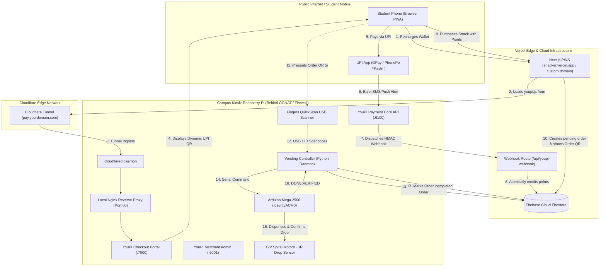

# Plan B: Hybrid Cloud Architecture (Vercel Frontend + Pi via Cloudflare Tunnel & Nginx) ☁️🥧

This document details the **production-recommended hybrid topology** for SNACKER:
- **Frontend PWA & Webhook Receiver**: Hosted on **Vercel** with worldwide CDN caching, serverless API routes, and automated SSL.
- **Physical Kiosk & Payment Gateway**: Hosted on **Raspberry Pi** located on a local campus / home network behind **Cloudflare Tunnel (`cloudflared`)** multiplexed by local **Nginx**.

---

## 📑 Table of Contents

- [1. Architecture & Data Flow](#1-architecture--data-flow)
- [2. Why Plan B is the Gold Standard for Campus Kiosks](#2-why-plan-b-is-the-gold-standard-for-campus-kiosks)
- [3. Frontend Setup on Vercel](#3-frontend-setup-on-vercel)
  - [Vercel Environment Variables](#vercel-environment-variables)
  - [Next.js Raw Body Handling for Webhook](#nextjs-raw-body-handling-for-webhook)
- [4. Raspberry Pi Setup: Cloudflared + Nginx](#4-raspberry-pi-setup-cloudflared--nginx)
  - [Step 1: Configure Local Nginx on Pi](#step-1-configure-local-nginx-on-pi)
  - [Step 2: Install & Authenticate Cloudflared](#step-2-install--authenticate-cloudflared)
  - [Step 3: Configure Cloudflared Ingress to Nginx](#step-3-configure-cloudflared-ingress-to-nginx)
  - [Step 4: Configure YouPI-PG Environment on Pi](#step-4-configure-youpi-pg-environment-on-pi)
- [5. Hardware Vending Controller (Local Daemon)](#5-hardware-vending-controller-local-daemon)
- [6. Security Invariants & Protected Ports](#6-security-invariants--protected-ports)
- [7. Step-by-Step Verification Runbook](#7-step-by-step-verification-runbook)

---

## 1. Architecture & Data Flow



---

## 2. Why Plan B is the Gold Standard for Campus Kiosks

1. **Bypasses College Firewalls & CGNAT**:
   - Institutional Wi-Fi / Ethernet connections almost never grant public static IPs or permit port forwarding (inbound ports `80` and `443` are blocked).
   - `cloudflared` initiates an **outbound-only connection** to Cloudflare's nearest edge data center over encrypted HTTP/2 or QUIC. No firewall exceptions required.
2. **High Availability & Global CDN**:
   - The user interface is served instantly from Vercel's global CDN with 100% uptime. Students can browse products, check their wallet balance, or view order history even if the physical kiosk is temporarily power-cycled or rebooting.
3. **Hardware Isolation**:
   - The Raspberry Pi only processes two tasks: running the YouPI dynamic UPI queue and driving physical hardware (QuickScan reader, Arduino relays, IR sensors).
4. **Automatic SSL / Zero Certbot Renewal Headaches**:
   - Vercel automatically provisions and renews SSL for the web app.
   - Cloudflare automatically provides edge SSL for the tunnel domain (`https://pay.yourdomain.com`).

---

## 3. Frontend Setup on Vercel

### Vercel Environment Variables
Deploy the [`snacker`](file:///C:/dev/snacker) repository on Vercel and configure these Environment Variables under **Project Settings ➔ Environment Variables**:

| Variable | Target Value | Description |
| :--- | :--- | :--- |
| `NEXT_PUBLIC_YOUPI_HOST` | `https://pay.yourdomain.com` | Public Cloudflare Tunnel URL serving `youpi.js` and Checkout Portal |
| `YOUPI_GATEWAY_URL` | `https://pay.yourdomain.com/api/v1` | Public API endpoint for server-side payment session creation |
| `YOUPI_MERCHANT_ID` | `snacker-merchant-01` | Merchant identifier configured in YouPI-PG |
| `YOUPI_WEBHOOK_SECRET` | *(Random 32+ char secret)* | Shared secret for verifying webhook HMAC-SHA256 signatures |
| `NEXT_PUBLIC_CLERK_PUBLISHABLE_KEY` | `pk_live_...` | Clerk Production Publishable Key |
| `CLERK_SECRET_KEY` | `sk_live_...` | Clerk Secret Key |
| `NEXT_PUBLIC_FIREBASE_PROJECT_ID` | `snacker-app` | Firebase Project ID |
| `FIREBASE_SERVICE_ACCOUNT_KEY` | `'{"type":"service_account",...}'` | Full JSON credentials string of privileged Firebase service account |

> [!TIP]
> After setting your production domain on Vercel (e.g. `https://snacker.yourdomain.com`), remember to whitelist this domain in **Firebase Console ➔ Authentication ➔ Settings ➔ Authorized Domains**.

---

## 4. Raspberry Pi Setup: Cloudflared + Nginx

### Step 1: Configure Local Nginx on Pi
In this plan, Nginx on the Raspberry Pi does **not** need to handle SSL certificates directly, because Cloudflare Edge terminates HTTPS. Nginx listens locally on port `80` and distributes traffic received from `cloudflared`:

Create `/etc/nginx/sites-available/snacker-kiosk`:

```nginx
# Map WebSocket Upgrade header for live SSE / WebSocket streams
map $http_upgrade $connection_upgrade {
    default upgrade;
    ''      close;
}

server {
    listen 80 default_server;
    listen [::]:80 default_server;
    server_name _;

    client_max_body_size 25M;

    # 1. YouPI-PG Checkout Portal & youpi.js SDK (Port 7000)
    location = /youpi.js {
        proxy_pass http://127.0.0.1:7000/youpi.js;
        proxy_set_header Host $host;
        proxy_set_header X-Real-IP $remote_addr;
        proxy_set_header X-Forwarded-For $proxy_add_x_forwarded_for;
        proxy_set_header X-Forwarded-Proto https;
    }

    location /checkout/ {
        proxy_pass http://127.0.0.1:7000/checkout/;
        proxy_http_version 1.1;
        proxy_set_header Host $host;
        proxy_set_header X-Real-IP $remote_addr;
        proxy_set_header X-Forwarded-For $proxy_add_x_forwarded_for;
        proxy_set_header X-Forwarded-Proto https;

        # Disable buffering for live Server-Sent Events (SSE) payment status
        proxy_buffering off;
        proxy_cache off;
        proxy_read_timeout 86400s;
    }

    # 2. YouPI-PG Payment Core REST API (Port 6100)
    location /api/v1/ {
        proxy_pass http://127.0.0.1:6100/api/v1/;
        proxy_http_version 1.1;
        proxy_set_header Host $host;
        proxy_set_header X-Real-IP $remote_addr;
        proxy_set_header X-Forwarded-For $proxy_add_x_forwarded_for;
        proxy_set_header X-Forwarded-Proto https;

        # Support real-time streaming & WebSocket connection upgrades
        proxy_set_header Upgrade $http_upgrade;
        proxy_set_header Connection $connection_upgrade;
        proxy_buffering off;
        proxy_read_timeout 86400s;
    }

    # 3. YouPI-PG Merchant Admin Dashboard (Port 6001)
    location /youpi-admin/ {
        proxy_pass http://127.0.0.1:6001/;
        proxy_http_version 1.1;
        proxy_set_header Host $host;
        proxy_set_header X-Real-IP $remote_addr;
        proxy_set_header X-Forwarded-For $proxy_add_x_forwarded_for;
        proxy_set_header X-Forwarded-Proto https;
    }

    # Default fallback
    location / {
        proxy_pass http://127.0.0.1:7000;
        proxy_set_header Host $host;
    }
}
```

Enable the Nginx site:
```bash
sudo rm -f /etc/nginx/sites-enabled/default
sudo ln -sf /etc/nginx/sites-available/snacker-kiosk /etc/nginx/sites-enabled/
sudo nginx -t && sudo systemctl reload nginx
```

---

### Step 2: Install & Authenticate Cloudflared
On the Raspberry Pi:

```bash
# 1. Download official cloudflared package for ARM64
curl -L --output cloudflared.deb https://github.com/cloudflare/cloudflared/releases/latest/download/cloudflared-linux-arm64.deb
sudo dpkg -i cloudflared.deb

# 2. Authenticate with your Cloudflare account
cloudflared tunnel login

# 3. Create a dedicated tunnel for your vending kiosk
cloudflared tunnel create snacker-kiosk
```
*Note the returned Tunnel UUID (e.g. `d3b07384-d113-494a-a00a-112233445566`).*

---

### Step 3: Configure Cloudflared Ingress to Nginx
Create `/etc/cloudflared/config.yml`:

```yaml
tunnel: <YOUR_TUNNEL_UUID>
credentials-file: /home/pi/.cloudflared/<YOUR_TUNNEL_UUID>.json

ingress:
  # Route the public payment hostname directly to local Nginx on Port 80
  - hostname: pay.yourdomain.com
    service: http://localhost:80
    originRequest:
      noTLSVerify: true
      connectTimeout: 30s

  # Catch-all rule (required by Cloudflare)
  - service: http_status:404
```

Route the DNS record in Cloudflare:
```bash
cloudflared tunnel route dns snacker-kiosk pay.yourdomain.com
```

Install and start `cloudflared` as a persistent system service:
```bash
sudo cloudflared service install
sudo systemctl enable cloudflared
sudo systemctl start cloudflared
```

---

### Step 4: Configure YouPI-PG Environment on Pi
In `/home/pi/youpi-pg/.env`:

```ini
NODE_ENV=production
CONTROL_CENTER_PORT=8090
PAYMENT_API_PORT=6100
CHECKOUT_PORTAL_PORT=7000
MERCHANT_ADMIN_PORT=6001

# Embedded SQLite for ARM64 Pi
USE_SQLITE_FALLBACK=true
SQLITE_DB_PATH=./data/youpi_pg.sqlite

# Point URLs to the public Cloudflare Tunnel domain
BASE_PAYMENT_API_URL=https://pay.yourdomain.com/api/v1
BASE_CHECKOUT_URL=https://pay.yourdomain.com

# Point the webhook destination to Vercel production URL
MERCHANT_WEBHOOK_URL=https://snacker.vercel.app/api/youpi-webhook
MERCHANT_WEBHOOK_SECRET=snacker_youpi_secret_8899

PAYMENT_ACTIVE_WINDOW_MS=300000
PAYMENT_PROCESSING_WINDOW_MS=30000
```

Restart the YouPI gateway:
```bash
sudo systemctl restart youpi-pg.service
```

---

## 5. Hardware Vending Controller (Local Daemon)

The physical vending controller on the Pi ([`vending_controller.py`](file:///C:/dev/snacker-backend/hardware/pi/vending_controller.py)) communicates directly with Firebase Firestore:
1. It does **not** expose any HTTP ports to the internet.
2. It runs as a background service ([`snacker-vending.service`](file:///C:/dev/snacker-backend/hardware/pi/snacker-vending.service)).
3. It intercepts the **Fingers QuickScan USB Scanner** via Linux `evdev` (`scanner.grab()`).
4. It connects to **Arduino Mega 2560** via USB serial (`/dev/ttyACM0`).
5. When a QR code is scanned:
   - Queries Firestore `orders/{orderId}`.
   - Atomically updates status to `"dispensing"`.
   - Sends serial command `DISPENSE:<SLOT>:<QTY>` to Arduino.
   - Waits for IR drop sensor confirmation (`DONE:<SLOT>:VERIFIED`).
   - Updates Firestore order status to `"completed"`.
   - If an item jams, updates status to `"jammed"` and immediately refunds credits back to `users/{userId}.credit`.

---

## 6. Security Invariants & Protected Ports

> [!CAUTION]
> According to **YOUPI-PG Security Invariant 1**, never publish internal observer ports to Cloudflare:
> - **Port 6002 (SMS Observer)**: Keep internal to `localhost`.
> - **Port 6003 (Gmail Observer)**: Keep internal to `localhost`.
> - **Port 8090 (Control Center)**: Keep internal to `localhost`.
> 
> Only route public traffic through Nginx to Port 7000 (Checkout) and Port 6100 (Payment API).

---

## 7. Step-by-Step Verification Runbook

### 1. Test Cloudflare Tunnel Ingress
From any external device (or phone on cellular 4G/5G):
```bash
curl -I https://pay.yourdomain.com/youpi.js
```
*Expected Output: `HTTP/2 200 OK` (served from Pi through Cloudflare Tunnel).*

### 2. Test Vercel Webhook Verification
From the Pi terminal, trigger a test payment webhook to Vercel:
```bash
cd /home/pi/snacker
BACKEND_URL=https://snacker.vercel.app npm run test:webhook
```
*Expected Output: `✅ Security check passed: Tampered signatures correctly rejected!`*

### 3. Check Live Raspberry Pi Status
```bash
# Check Cloudflare Tunnel health
sudo systemctl status cloudflared

# Check YouPI payment gateway logs
sudo journalctl -u youpi-pg.service -f

# Check hardware scanner and Arduino logs
sudo journalctl -u snacker-vending.service -f
```
