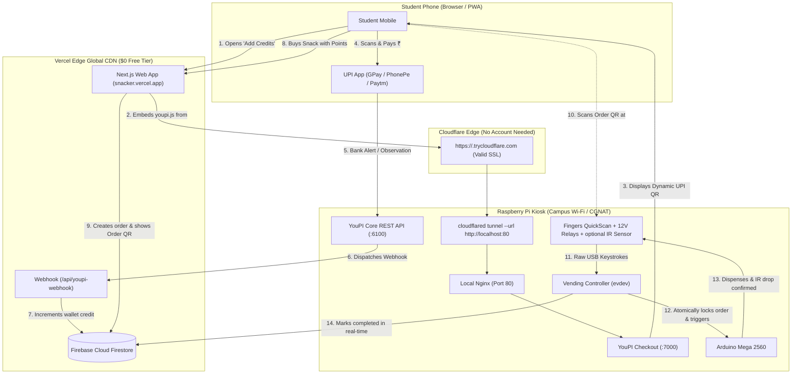

# Plan B: Zero-Domain Architecture (Vercel + Pure Cloudflared Quick Tunnel via Pi Nginx) ⚡🥧

This document details the **zero-domain, zero-cost production/demo architecture** for SNACKER:
- **Frontend PWA**: Hosted on **Vercel** (`https://snacker.vercel.app`) with worldwide CDN and serverless webhooks.
- **Pi Ingress**: Exposed via **Pure Cloudflare Quick Tunnels (`*.trycloudflare.com`)** pointing to local **Nginx**.
- **Hardware & Payment**: **YouPI-PG** and Python **Vending Controller** running locally on the Raspberry Pi.
- **Cost**: **$0.00** (No custom domain purchased, no credit card, no Cloudflare account login required).

---

## 📑 Table of Contents

- [1. Architecture Overview](#1-architecture-overview)
- [2. Context7 Feasibility Audit](#2-context7-feasibility-audit)
  - [What Works Out of the Box](#what-works-out-of-the-box)
  - [The Ephemeral URL Challenge & Solutions](#the-ephemeral-url-challenge--solutions)
- [3. Local Nginx Configuration on the Pi](#3-local-nginx-configuration-on-the-pi)
- [4. Starting the Quick Tunnel](#4-starting-the-quick-tunnel)
- [5. Automated Firestore Tunnel Sync (Zero-Maintenance Solution)](#5-automated-firestore-tunnel-sync-zero-maintenance-solution)
- [6. Frontend Configuration on Vercel](#6-frontend-configuration-on-vercel)
- [7. Comparison: Custom Domain vs. Pure Quick Tunnel](#7-comparison-custom-domain-vs-pure-quick-tunnel)

---

## 1. Architecture Overview



---

## 2. Context7 Feasibility Audit

According to official Cloudflare documentation retrieved via Context7:

```sh
cloudflared tunnel --url http://localhost:80
```

### What Works Out of the Box:
1. **Zero Domain & Zero Cloudflare Account**:
   - `cloudflared` registers a free endpoint under `https://<generated-words>.trycloudflare.com`.
   - No login, credit card, or domain registration is required.
2. **Valid Public SSL Certificates**:
   - Cloudflare Edge provides a signed, trusted SSL certificate for `*.trycloudflare.com`.
   - Browser PWA rules and HTTPS script embedding (`<script src="https://...trycloudflare.com/youpi.js">`) work without mixed-content warnings.
3. **WebSockets & Server-Sent Events (SSE)**:
   - Quick Tunnels natively support HTTP/2 and WebSocket upgrades, enabling real-time payment status streams from `/api/v1/checkout/:id/stream`.
4. **Outbound-Only Ingress**:
   - Bypasses institutional firewalls, CGNAT, and 4G/5G mobile hotspot networks.

### The Ephemeral URL Challenge & Solutions:
- **The Behavior**: Whenever `cloudflared` stops or restarts, Cloudflare allocates a **new random subdomain** (e.g. `https://fast-tiger-12.trycloudflare.com` becomes `https://blue-ocean-99.trycloudflare.com`).
- **Solutions**:
  - **For Hackathons / Live Demos**: Run `cloudflared` once; the URL stays alive continuously for the entire session.
  - **For Hands-Off Autonomous Operation**: Use the **Automated Firestore Tunnel Sync** daemon (detailed in [Section 5](#5-automated-firestore-tunnel-sync-zero-maintenance-solution)) so Vercel always pulls the active tunnel URL automatically without manual redeployments!

---

## 3. Local Nginx Configuration on the Pi

Nginx listens locally on port `80`. The Cloudflare Quick Tunnel points to this single port, and Nginx multiplexes internal traffic:

Create `/etc/nginx/sites-available/snacker-quick`:

```nginx
map $http_upgrade $connection_upgrade {
    default upgrade;
    ''      close;
}

server {
    listen 80 default_server;
    listen [::]:80 default_server;
    server_name _;

    client_max_body_size 25M;

    # 1. YouPI-PG SDK Script (served to Vercel PWA)
    location = /youpi.js {
        proxy_pass http://127.0.0.1:7000/youpi.js;
        proxy_set_header Host $host;
        proxy_set_header X-Real-IP $remote_addr;
        proxy_set_header X-Forwarded-For $proxy_add_x_forwarded_for;
        proxy_set_header X-Forwarded-Proto https;
    }

    # 2. YouPI-PG Checkout Screens & Live SSE Payment Stream
    location /checkout/ {
        proxy_pass http://127.0.0.1:7000/checkout/;
        proxy_http_version 1.1;
        proxy_set_header Host $host;
        proxy_set_header X-Real-IP $remote_addr;
        proxy_set_header X-Forwarded-For $proxy_add_x_forwarded_for;
        proxy_set_header X-Forwarded-Proto https;

        # Disable buffering so SSE live updates reach student's phone instantly
        proxy_buffering off;
        proxy_cache off;
        proxy_read_timeout 86400s;
    }

    # 3. YouPI-PG Payment Core REST API
    location /api/v1/ {
        proxy_pass http://127.0.0.1:6100/api/v1/;
        proxy_http_version 1.1;
        proxy_set_header Host $host;
        proxy_set_header X-Real-IP $remote_addr;
        proxy_set_header X-Forwarded-For $proxy_add_x_forwarded_for;
        proxy_set_header X-Forwarded-Proto https;

        proxy_set_header Upgrade $http_upgrade;
        proxy_set_header Connection $connection_upgrade;
        proxy_buffering off;
        proxy_read_timeout 86400s;
    }

    # 4. Merchant Admin Dashboard (Optional Kiosk Access)
    location /youpi-admin/ {
        proxy_pass http://127.0.0.1:6001/;
        proxy_set_header Host $host;
    }

    # Default fallback
    location / {
        proxy_pass http://127.0.0.1:7000;
        proxy_set_header Host $host;
    }
}
```

Enable in Nginx:
```bash
sudo rm -f /etc/nginx/sites-enabled/default
sudo ln -sf /etc/nginx/sites-available/snacker-quick /etc/nginx/sites-enabled/
sudo nginx -t && sudo systemctl reload nginx
```

---

## 4. Starting the Quick Tunnel

To manually test or launch the tunnel on the Pi:

```bash
cloudflared tunnel --url http://localhost:80
```

Sample output:
```txt
2026-10-21T21:30:00Z INF Initial protocol h2mux
2026-10-21T21:30:02Z INF Connection established connIndex=0
+-----------------------------------------------------------------------+
|  Your free tunnel has started! Visit it:                              |
|    https://ancient-sample-word-sf.trycloudflare.com                   |
+-----------------------------------------------------------------------+
```

Copy the assigned URL (e.g. `https://ancient-sample-word-sf.trycloudflare.com`).

---

## 5. Automated Firestore Tunnel Sync (Zero-Maintenance Solution)

To make the Quick Tunnel persistent across reboot cycles without manually copying the new `trycloudflare.com` URL into Vercel, use this lightweight Python daemon on the Pi:

### Script: `/home/pi/snacker/hardware/pi/sync_quick_tunnel.py`

```python
#!/usr/bin/env python3
"""
Quick Tunnel Firestore Auto-Synchronizer
Runs cloudflared, captures the generated trycloudflare.com URL from stderr,
and writes it directly to Firestore doc: config/gateway
"""

import subprocess
import re
import sys
import time
import firebase_admin
from firebase_admin import credentials, firestore

FIREBASE_KEY = "/home/pi/snacker/serviceAccountKey.json"

# Initialize Firebase
cred = credentials.Certificate(FIREBASE_KEY)
firebase_admin.initialize_app(cred)
db = firestore.client()

def main():
    print("[TUNNEL-SYNC] Starting Cloudflare Quick Tunnel pointing to Port 80...")
    cmd = ["cloudflared", "tunnel", "--url", "http://localhost:80"]
    
    # Cloudflared prints the trycloudflare URL to stderr
    proc = subprocess.Popen(cmd, stdout=subprocess.PIPE, stderr=subprocess.PIPE, text=True)

    url_found = False
    url_pattern = re.compile(r"https://[a-zA-Z0-9-]+\.trycloudflare\.com")

    for line in proc.stderr:
        print(line, end="")
        match = url_pattern.search(line)
        if match and not url_found:
            tunnel_url = match.group(0)
            url_found = True
            print(f"\n[FOUND TUNNEL URL] -> {tunnel_url}")
            
            # Sync to Firestore
            db.collection("config").document("gateway").set({
                "hostUrl": tunnel_url,
                "paymentApiUrl": f"{tunnel_url}/api/v1",
                "checkoutUrl": tunnel_url,
                "updatedAt": firestore.SERVER_TIMESTAMP,
                "status": "online"
            })
            print("[SYNCED] Live tunnel URL updated in Firestore (config/gateway)!\n")

    proc.wait()

if __name__ == "__main__":
    main()
```

### Systemd Service: `/etc/systemd/system/snacker-quick-tunnel.service`

```ini
[Unit]
Description=Snacker Cloudflare Quick Tunnel & Live Firestore Sync
After=network.target nginx.service

[Service]
Type=simple
User=pi
WorkingDirectory=/home/pi/snacker
ExecStart=/home/pi/snacker/venv/bin/python3 /home/pi/snacker/hardware/pi/sync_quick_tunnel.py
Restart=always
RestartSec=5

StandardOutput=journal
StandardError=journal

[Install]
WantedBy=multi-user.target
```

Enable on boot:
```bash
sudo systemctl daemon-reload
sudo systemctl enable snacker-quick-tunnel.service
sudo systemctl start snacker-quick-tunnel.service
```

---

## 6. Frontend Configuration on Vercel

In your Vercel Project Settings:

1. **Environment Variables**:
   - `NEXT_PUBLIC_YOUPI_MERCHANT_ID`: `snacker-merchant-01`
   - `YOUPI_WEBHOOK_SECRET`: a random value from `openssl rand -hex 32` (must match the gateway's `MERCHANT_WEBHOOK_SECRET`)
   - If using manual URL:
     - `NEXT_PUBLIC_YOUPI_HOST`: `https://ancient-sample-word-sf.trycloudflare.com`
     - `YOUPI_GATEWAY_URL`: `https://ancient-sample-word-sf.trycloudflare.com/api/v1`
   - If using the **Automated Firestore Sync**, the frontend dynamically reads `config/gateway` on client mount, requiring **zero** manual redeployments!

2. **Webhook Endpoint on Vercel**:
   - The Pi's YouPI-PG instance sends payments directly to:
     `https://snacker.vercel.app/api/youpi-webhook`
   - Vercel executes the serverless handler, validates the HMAC-SHA256 signature, and credits the user's Firestore wallet balance.

---

## 7. Comparison: Custom Domain vs. Pure Quick Tunnel

| Feature | Custom Domain Named Tunnel (`pay.yourdomain.com`) | Pure Quick Tunnel (`*.trycloudflare.com`) |
| :--- | :--- | :--- |
| **Cost** | Domain registration fee ($5–$12/year) | **$0.00 (Completely Free)** |
| **Domain Ownership** | Required | **None needed** |
| **Cloudflare Account** | Free account required | **No account needed at all** |
| **URL Stability** | Permanent static URL | Changes on process restart *(auto-synced via Firestore)* |
| **SSL Quality** | Cloudflare Edge Wildcard SSL | Cloudflare Edge Wildcard SSL |
| **Port Forwarding / Router** | Zero port forwarding required | Zero port forwarding required |
| **PWA Compliance** | 100% compliant | 100% compliant |
| **Best Used For** | Permanent Multi-Campus Production | Hackathons, Campus Demos, Testing, Budget-Constrained Kiosks |
